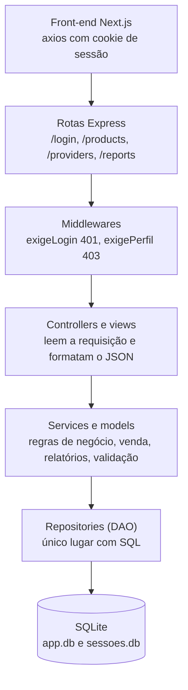

# Sistema de Vendas RGR

Sistema web de estoque e vendas de uma loja de roupas. O gerente (ADM) cadastra produtos e fornecedores, retira unidades do estoque e consulta relatórios de vendas; o funcionário consulta produtos e fornecedores e registra as vendas, que dão baixa automática no estoque.

Projeto Web Final de Programação para Web Avançada.

| | |
| --- | --- |
| **Grupo** | RGR (Loja de Roupas) - Venda e Estoque |
| **Integrantes** | Flávio Ramos (back-end), Klinsmann Luiz (front-end), Raphael Bezerra (documentação) e Carlos Gabriel (testes) |
| **Aplicação publicada** | (link do front) |
| **API publicada** | (link da API) |
| **Documentação da API** | (link da API)/docs |

## Funcionalidades

| Funcionalidade | ADM | Funcionário |
| --- | :---: | :---: |
| Login e logout | ✅ | ✅ |
| Consultar produtos e fornecedores | ✅ | ✅ |
| Registrar venda com baixa automática no estoque | ✅ | ✅ |
| Cadastrar, editar e excluir produtos | ✅ | ❌ (403) |
| Cadastrar, editar e excluir fornecedores (com busca de endereço pelo CEP) | ✅ | ❌ (403) |
| Retirar unidades do estoque sem venda | ✅ | ❌ (403) |
| Consultar relatórios de vendas | ✅ | ❌ (403) |

O controle de acesso é feito no back-end: sem login a API responde 401 e, com perfil sem permissão, 403.

## Tecnologias

| Parte | Tecnologias |
| --- | --- |
| Back-end | Node.js, Express 5, express-session, connect-sqlite3, bcryptjs, cors, dotenv, swagger-ui-express |
| Banco de dados | SQLite (better-sqlite3) |
| Front-end | Next.js 16, React 19, TypeScript, Mantine, Tailwind CSS, shadcn/ui, axios |
| Serviço externo | ViaCEP (endereço pelo CEP) |
| Testes | Jest e Supertest (back-end), Cypress (front-end) |

## Arquitetura

O back-end segue MVC com camadas de service e repository. Cada requisição passa pelas camadas abaixo:



| Papel no MVC | Pastas | Responsabilidade |
| --- | --- | --- |
| Model | `models/`, `services/`, `repositories/` | Validação dos dados, regras de negócio e acesso ao banco |
| View | `views/` | Formata produtos e fornecedores no JSON enviado ao front |
| Controller | `controllers/` | Lê a requisição, chama o service e devolve status HTTP + JSON |

- **Sessão:** express-session guarda a sessão no servidor (`sessoes.db`); o navegador recebe só o cookie `connect.sid` (httpOnly, 30 minutos).
- **CORS:** a API aceita só a origem de `FRONTEND_ORIGIN`, com `credentials: true`.
- **Venda:** a baixa no estoque e o registro da venda ficam numa única transação, e o estoque nunca fica negativo.
- **Front-end:** o `proxy.ts` manda as telas `/rgr` para o login quando não há sessão; erros da API abrem as páginas `/erro/<código>`.

Mais detalhes em [backend/README.md](backend/README.md) e [frontend/README.md](frontend/README.md).

## Estrutura de pastas

```text
progWebSemestral/
├── backend/
│   ├── server.js              inicia a API (porta 3001)
│   ├── .env.example
│   └── src/
│       ├── app.js             CORS, sessão, Swagger e rotas
│       ├── config/            banco, sessão, usuários iniciais, Swagger
│       ├── routes/            URLs e middlewares de cada uma
│       ├── middlewares/       exigeLogin, exigePerfil, tratamento de erros
│       ├── controllers/
│       ├── views/
│       ├── services/
│       ├── models/
│       ├── repositories/
│       ├── utils/
│       └── test/              testes Jest + Supertest
└── frontend/
    ├── proxy.ts               protege as telas /rgr
    ├── app/                   login, telas em rgr/, páginas de erro
    ├── services/              chamadas à API e ao ViaCEP
    ├── utils/                 máscaras de CEP, CPF/CNPJ e telefone
    └── cypress/               testes E2E
```

## Como executar localmente

Pré-requisitos: Node.js 20 ou superior. Use um terminal para cada parte.

**Back-end** (http://localhost:3001)

```bash
cd backend
npm install
cp .env.example .env
npm start
```

Antes de iniciar, preencha `SESSION_SECRET` e as senhas no `backend/.env`. Os usuários ADM e FUNCIONARIO são criados a partir desse arquivo na primeira execução.

**Front-end** (http://localhost:3000)

```bash
cd frontend
npm install
cp .env.example .env.local
npm run dev
```

Depois, acesse http://localhost:3000/login.

| Variável | Camada | Descrição |
| --- | --- | --- |
| `PORT` | backend | Porta da API (3001) |
| `FRONTEND_ORIGIN` | backend | Endereço do front liberado no CORS |
| `SESSION_SECRET` | backend | Texto longo e aleatório que assina o cookie |
| `ADM_EMAIL`, `ADM_SENHA` | backend | Usuário ADM criado na primeira execução |
| `FUNCIONARIO_EMAIL`, `FUNCIONARIO_SENHA` | backend | Usuário FUNCIONARIO criado na primeira execução |
| `NEXT_PUBLIC_API_URL` | frontend | Endereço da API |

## Credenciais de teste

| Perfil | E-mail | Senha |
| --- | --- | --- |
| ADM (administrador) | admin@rgr.com | (senha) |
| FUNCIONARIO (cliente) | funcionario@rgr.com | (senha) |

## Endpoints da API

Todas as rotas usam JSON. Erros aparecem como `{ "erro": "mensagem" }`. A documentação interativa fica em `/docs` (Swagger).

| Método | Rota | Descrição | Acesso |
| --- | --- | --- | --- |
| POST | `/login` | Inicia a sessão | Público |
| GET | `/perfil` | Usuário logado | ADM, Funcionário |
| POST | `/logout` | Encerra a sessão | Público |
| GET | `/products` | Lista produtos em `{ data }` | ADM, Funcionário |
| GET | `/products/:id` | Busca um produto | ADM, Funcionário |
| POST | `/products` | Cadastra produto | ADM |
| PUT | `/products/:id` | Atualiza produto | ADM |
| DELETE | `/products/:id?quantidade=N` | Retira N unidades do estoque | ADM |
| DELETE | `/products/:id` | Exclui produto | ADM |
| PATCH | `/products/:id/sale` | Registra venda e baixa o estoque | ADM, Funcionário |
| GET | `/providers` | Lista fornecedores | ADM, Funcionário |
| GET | `/providers/:id` | Busca um fornecedor | ADM, Funcionário |
| POST | `/providers` | Cadastra fornecedor | ADM |
| PUT | `/providers/:id` | Atualiza fornecedor | ADM |
| DELETE | `/providers/:id` | Exclui fornecedor sem produtos | ADM |
| GET | `/reports` | Relatório completo do período | ADM |
| GET | `/reports/sales/summary` | Faturamento, vendas, itens e ticket médio | ADM |
| GET | `/reports/sales/analysis` | Produto mais vendido e percentual | ADM |
| GET | `/reports/sales/top-products` | Ranking dos produtos | ADM |

As rotas de relatório exigem `?dataInicio=AAAA-MM-DD&dataFim=AAAA-MM-DD`.

### Exemplos

**Login**

```http
POST /login
{ "username": "admin@rgr.com", "password": "<senha>" }
```

```json
200 OK
{ "mensagem": "Sessão iniciada com sucesso",
  "usuario": { "id": 1, "nome": "Gerente", "email": "admin@rgr.com", "perfil": "ADM" } }

401 Unauthorized
{ "erro": "Credenciais inválidas" }
```

**Cadastrar produto (ADM)**

```http
POST /products
{ "sku": "CAM-001", "nome": "Camiseta", "categoria": "Camisa", "valor": 50,
  "quantidade": 30, "tamanho": "M", "fornecedorId": 1 }
```

```json
201 Created
{ "id": 1, "sku": "CAM-001", "nome": "Camiseta", "valor": 50, "quantidade": 30, ... }

400 Bad Request
{ "erro": "O nome é obrigatório; O valor deve ser maior que zero" }

403 Forbidden (funcionário)
{ "erro": "Seu perfil não tem permissão para esta ação" }
```

**Registrar venda**

```http
PATCH /products/1/sale
{ "quantidadeVendida": 2 }
```

```json
200 OK
{ "produto": { "id": 1, "nome": "Camiseta", "quantidade": 28, ... },
  "venda": { "id": 7, "produtoId": 1, "quantidade": 2, "valorUnitario": 50,
             "usuarioId": 2, "realizadaEm": "2026-11-09 17:10:00" } }

400 Bad Request
{ "erro": "Estoque insuficiente: há 1 unidade(s) disponível(is)" }
```

**Retirar unidades do estoque (ADM)**

```http
DELETE /products/1?quantidade=4
```

```json
200 OK
{ "id": 1, "nome": "Camiseta", "quantidade": 24, ... }
```

**Cadastrar fornecedor (ADM)**

```http
POST /providers
{ "nome": "Malharia Brasil LTDA", "telefone": "(67) 99999-0000", "cidade": "Campo Grande", "estado": "MS" }
```

```json
201 Created
{ "id": "1", "nome": "Malharia Brasil LTDA", "estado": "MS", ... }

409 Conflict (ao excluir com produtos vinculados)
{ "erro": "Fornecedor possui produtos vinculados" }
```

**Resumo de vendas (ADM)**

```http
GET /reports/sales/summary?dataInicio=2026-11-01&dataFim=2026-11-30
```

```json
200 OK
{ "faturamentoTotal": 350, "vendasRealizadas": 3, "itensVendidos": 7, "ticketMedio": 116.67 }

400 Bad Request
{ "erro": "Informe dataInicio e dataFim no formato AAAA-MM-DD" }
```

## Testes

**Back-end** (Jest + Supertest). Não precisa de `.env`: os testes criam um banco temporário próprio.

```bash
cd backend
npm test                     # todos os testes
npx jest --coverage          # com relatório de cobertura
```

**Front-end** (Cypress), com a API e o front rodando:

```bash
cd frontend
npx cypress run              # todos os testes
npx cypress open             # modo interativo
```

A documentação de testes (plano, casos, rastreabilidade e relatório de execução) está em [docs/](docs/).
