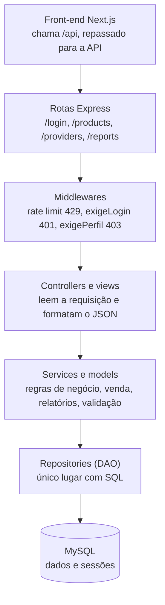
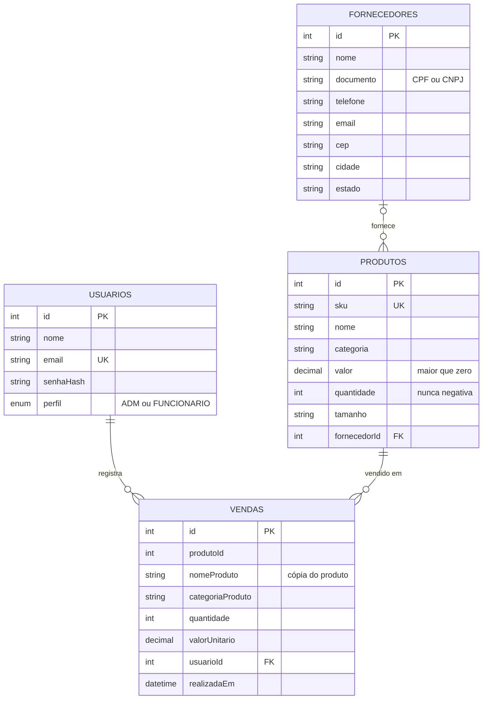

# Sistema de Vendas RGR

Sistema web de estoque e vendas de uma loja de roupas. O gerente (ADM) cadastra produtos e fornecedores, retira unidades do estoque e consulta relatórios de vendas; o funcionário consulta produtos e fornecedores e registra as vendas, que dão baixa automática no estoque.

Projeto Web Final de Programação para Web Avançada.

| | |
| --- | --- |
| **Grupo** | RGR (Loja de Roupas) - Venda e Estoque |
| **Integrantes** | Flávio Ramos (back-end), Klinsmann Luiz (front-end), Raphael Bezerra (documentação) e Carlos Gabriel (testes) |
| **Aplicação publicada** | (link do front) |
| **API publicada** | (link da API) |
| **Documentação da API** | (link da API)/docs |
| **Repositório** | (link do GitHub) |

## Funcionalidades

| Funcionalidade | ADM | Funcionário |
| --- | :---: | :---: |
| Login e logout | ✅ | ✅ |
| Consultar produtos e fornecedores | ✅ | ✅ |
| Registrar venda com baixa automática no estoque | ✅ | ✅ |
| Cadastrar, editar e excluir produtos | ✅ | ❌ (403) |
| Cadastrar, editar e excluir fornecedores (com busca de endereço pelo CEP e de dados pelo CNPJ) | ✅ | ❌ (403) |
| Retirar unidades do estoque sem venda | ✅ | ❌ (403) |
| Consultar relatórios de vendas | ✅ | ❌ (403) |

O controle de acesso é feito no back-end: sem login a API responde 401 e, com perfil sem permissão, 403. Esconder botões no front é só conveniência; quem bloqueia é a API.

**Níveis de acesso pedidos no enunciado**

| Nível do enunciado | Perfil no sistema | O que faz |
| --- | --- | --- |
| Cliente (usuário) | FUNCIONARIO (vendedor) | Usuário final do dia a dia: consulta o estoque e os fornecedores e registra as vendas |
| Administrador | ADM (gerente) | Gerencia os registros: cadastro, edição e remoção de produtos e fornecedores, retirada de estoque e relatórios |

## Tecnologias

| Parte | Tecnologias |
| --- | --- |
| Back-end | Node.js, Express 5, express-session, express-mysql-session, bcryptjs, helmet, express-rate-limit, cors, dotenv, swagger-ui-express |
| Banco de dados | MySQL 8 (mysql2), compatível com MariaDB 10.4+ |
| Front-end | Next.js 16, React 19, TypeScript, Mantine, Tailwind CSS, shadcn/ui, axios, sonner |
| Serviços externos | ViaCEP (endereço pelo CEP) e BrasilAPI (dados da empresa pelo CNPJ) |
| Testes | Jest e Supertest (back-end), Cypress (front-end) |

## Arquitetura

O back-end segue MVC com camadas de service e repository. Cada requisição passa pelas camadas abaixo:



| Papel no MVC | Pastas | Responsabilidade |
| --- | --- | --- |
| Model | `models/`, `services/`, `repositories/` | Validação dos dados, regras de negócio e acesso ao banco |
| View | `views/` | Formata produtos e fornecedores no JSON enviado ao front |
| Controller | `controllers/` | Lê a requisição, chama o service e devolve status HTTP + JSON |

- **Sessão:** express-session guarda a sessão no MySQL (tabela `sessions`); o navegador recebe só o cookie `connect.sid` (httpOnly, 30 minutos, só HTTPS em produção).
- **CORS:** configurado de forma explícita no `app.js` com o pacote `cors`: só as origens listadas em `FRONTEND_ORIGIN` (separadas por vírgula) são aceitas, com `credentials: true` para o cookie de sessão. Como o front chama a API pelo caminho `/api` do próprio site, o navegador normalmente não faz requisição de outra origem. O CORS vale quando a API é chamada diretamente, como a partir de `http://localhost:3000` para `http://localhost:3001`.
- **Comunicação front → API:** o navegador chama `/api/...` no próprio site, e o Next.js repassa para a API. Assim o cookie fica no domínio do site e o `proxy.ts` consegue ler a sessão.
- **Proteção contra abuso:** limite de 300 requisições por IP a cada 15 minutos e de 10 tentativas de login erradas; acima disso a API responde 429.
- **Venda:** a baixa no estoque e o registro da venda ficam numa única transação, e o estoque nunca fica negativo.
- **Front-end:** o `proxy.ts` manda as telas `/rgr` para o login quando não há sessão; erros da API abrem as páginas `/erro/<código>`.

Mais detalhes em [backend/README.md](backend/README.md) e [frontend/README.md](frontend/README.md).

### Modelo de dados



A venda guarda uma cópia do nome, da categoria e do valor do produto. Por isso `produtoId` não tem chave estrangeira, e os relatórios antigos continuam certos mesmo que o produto seja editado ou excluído. As sessões de login ficam na tabela `sessions`. A estrutura completa está em [backend/sql/schema.sql](backend/sql/schema.sql).

## Estrutura de pastas

```text
progWebSemestral/
├── DEPLOY.md                  passo a passo para publicar
├── docs/                      documentação de testes (VV&TS) e evidências
├── backend/
│   ├── server.js              inicia a API (porta 3001)
│   ├── .env.example
│   ├── sql/schema.sql         estrutura do banco MySQL (rodar em produção)
│   ├── scripts/criarBanco.js  npm run db:criar
│   └── src/
│       ├── app.js             CORS, sessão, Swagger e rotas
│       ├── config/            conexão MySQL, sessão, usuários iniciais, Swagger
│       ├── routes/            URLs e middlewares de cada uma
│       ├── middlewares/       rate limit, exigeLogin, exigePerfil, tratamento de erros
│       ├── controllers/
│       ├── views/
│       ├── services/
│       ├── models/
│       ├── repositories/
│       ├── utils/
│       └── test/              testes unitários (unit/) e de integração (Jest + Supertest)
└── frontend/
    ├── proxy.ts               protege as telas /rgr
    ├── next.config.ts         repassa /api para o back-end
    ├── app/                   login, telas em rgr/, páginas de erro
    ├── services/              chamadas à API, ao ViaCEP e à BrasilAPI
    ├── utils/                 máscaras de CEP, CPF/CNPJ e telefone
    └── cypress/               testes E2E
```

## Como executar localmente

Pré-requisitos: Node.js 20 ou superior e MySQL 8 (ou o MariaDB do XAMPP) rodando. Use um terminal para cada parte.

**Banco de dados**

Crie os bancos `rgr` (dados) e `rgr_teste` (testes automáticos) e um usuário com acesso aos dois. Os comandos SQL estão em [backend/README.md](backend/README.md#como-executar).

**Back-end** (http://localhost:3001)

```bash
cd backend
npm install
cp .env.example .env
npm run db:criar
npm start
```

Antes de criar as tabelas, preencha no `backend/.env` os dados do banco, o `SESSION_SECRET` e as senhas dos usuários. O `npm run db:criar` executa o `sql/schema.sql`. Os usuários ADM e FUNCIONARIO são criados a partir do `.env` na primeira execução.

**Front-end** (http://localhost:3000)

```bash
cd frontend
npm install
cp .env.example .env.local
npm run dev
```

Depois, acesse http://localhost:3000/login.

| Variável | Camada | Descrição |
| --- | --- | --- |
| `PORT` | backend | Porta da API (3001) |
| `FRONTEND_ORIGIN` | backend | Endereço do front liberado no CORS |
| `SESSION_SECRET` | backend | Texto longo e aleatório que assina o cookie |
| `ADM_EMAIL`, `ADM_SENHA` | backend | Usuário ADM criado na primeira execução |
| `FUNCIONARIO_EMAIL`, `FUNCIONARIO_SENHA` | backend | Usuário FUNCIONARIO criado na primeira execução |
| `DATABASE_URL` ou `DB_HOST`, `DB_PORT`, `DB_USER`, `DB_PASSWORD`, `DB_NAME` | backend | Conexão com o MySQL |
| `TEST_DB_NAME` | backend | Banco usado pelos testes (`rgr_teste`) |
| `DB_TIMEZONE` | backend | Fuso das vendas (`-04:00` para MS) |
| `DB_SSL`, `DB_SSL_CA` | backend | SSL para bancos em nuvem |
| `NODE_ENV`, `TRUST_PROXY` | backend | Produção: cookie só por HTTPS e quantidade de proxies |
| `LIMITE_GERAL`, `LIMITE_LOGIN` | backend | Rate limit (padrão: 300 e 10 a cada 15 minutos) |
| `NEXT_PUBLIC_API_URL` | frontend | Caminho que o navegador usa para a API (`/api`) |
| `API_URL` | frontend | Endereço real da API, para onde o Next repassa `/api` |

## Credenciais de teste

| Nível | Perfil | E-mail | Senha |
| --- | --- | --- | --- |
| Administrador | ADM (gerente) | admin@rgr.com | (senha) |
| Cliente | FUNCIONARIO (vendedor) | funcionario@rgr.com | (senha) |

Essas contas valem para a aplicação publicada. Rodando localmente, as senhas são as que você definiu em `ADM_SENHA` e `FUNCIONARIO_SENHA` no `backend/.env`.

## Endpoints da API

Todas as rotas usam JSON. Erros aparecem como `{ "erro": "mensagem" }`. A documentação interativa fica em `/docs` (Swagger). Pelo front, as mesmas rotas ficam em `/api/...`.

| Método | Rota | Descrição | Acesso |
| --- | --- | --- | --- |
| GET | `/saude` | Confere se a API e o banco estão no ar | Público |
| POST | `/login` | Inicia a sessão | Público |
| GET | `/perfil` | Usuário logado | ADM, Funcionário |
| POST | `/logout` | Encerra a sessão | Público |
| GET | `/products` | Lista produtos em `{ data }` | ADM, Funcionário |
| GET | `/products/:id` | Busca um produto | ADM, Funcionário |
| POST | `/products` | Cadastra produto | ADM |
| PUT | `/products/:id` | Atualiza produto | ADM |
| DELETE | `/products/:id?quantidade=N` | Retira N unidades do estoque | ADM |
| DELETE | `/products/:id` | Exclui produto | ADM |
| PATCH | `/products/:id/sale` | Registra venda e baixa o estoque | ADM, Funcionário |
| GET | `/providers` | Lista fornecedores | ADM, Funcionário |
| GET | `/providers/:id` | Busca um fornecedor | ADM, Funcionário |
| POST | `/providers` | Cadastra fornecedor | ADM |
| PUT | `/providers/:id` | Atualiza fornecedor | ADM |
| DELETE | `/providers/:id` | Exclui fornecedor sem produtos | ADM |
| GET | `/reports` | Relatório completo do período | ADM |
| GET | `/reports/sales/summary` | Faturamento, vendas, itens e ticket médio | ADM |
| GET | `/reports/sales/analysis` | Produto mais vendido e percentual | ADM |
| GET | `/reports/sales/top-products` | Ranking dos produtos | ADM |

As rotas de relatório exigem `?dataInicio=AAAA-MM-DD&dataFim=AAAA-MM-DD`.

**Códigos de status usados**

| Status | Quando |
| --- | --- |
| 200 OK | Consulta, edição, venda, retirada de estoque, login e logout |
| 201 Created | Produto ou fornecedor cadastrado |
| 204 No Content | Produto ou fornecedor excluído |
| 400 Bad Request | Dados inválidos, estoque insuficiente, período inválido ou JSON malformado |
| 401 Unauthorized | Sem sessão ou credenciais inválidas |
| 403 Forbidden | Perfil sem permissão (Funcionário em rota de ADM) |
| 404 Not Found | Produto, fornecedor ou rota inexistente |
| 409 Conflict | SKU repetido ou fornecedor com produtos vinculados |
| 429 Too Many Requests | Limite de requisições ou de tentativas de login atingido |
| 413 Payload Too Large | Corpo JSON maior que 100 KB |
| 500 Internal Server Error | Erro inesperado no servidor. Nesta versão, alguns valores numéricos fora do limite do banco também caem aqui (DEF-01 a DEF-03 no [relatório de testes](docs/relatorio-de-execucao.md#4-defeitos-encontrados)) |

Toda resposta da API vem com `Cache-Control: no-store` e os cabeçalhos de segurança do helmet. As respostas de rate limit trazem o cabeçalho `RateLimit` com as requisições restantes.

### Exemplos

**Login**

```http
POST /login
{ "username": "admin@rgr.com", "password": "<senha>" }
```

```json
200 OK
{ "mensagem": "Sessão iniciada com sucesso",
  "usuario": { "id": 1, "nome": "Gerente", "email": "admin@rgr.com", "perfil": "ADM" } }

401 Unauthorized
{ "erro": "Credenciais inválidas" }
```

**Usuário logado e logout**

```http
GET /perfil
POST /logout
```

```json
200 OK (GET /perfil)
{ "usuario": { "id": 1, "nome": "Gerente", "email": "admin@rgr.com", "perfil": "ADM" },
  "logadoEm": "2026-11-17T13:07:43.473Z" }

200 OK (POST /logout)
{ "mensagem": "Sessão encerrada" }

401 Unauthorized (qualquer rota protegida sem sessão)
{ "erro": "Faça login para continuar" }
```

**Listar produtos**

```http
GET /products
```

```json
200 OK
{ "data": [
  { "id": 1, "sku": "CAM-001", "nome": "Camiseta", "categoria": "Camisa", "valor": 50,
    "quantidade": 30, "tamanho": "M", "descricao": "", "imagem": "", "fornecedorId": "1",
    "name": "Camiseta", "category": "Camisa", "price": 50, "quantity": 30, "image": "" } ] }
```

Cada produto vem com os campos em português (usados no formulário) e em inglês (usados no dashboard).

**Cadastrar produto (ADM)**

```http
POST /products
{ "sku": "CAM-001", "nome": "Camiseta", "categoria": "Camisa", "valor": 50,
  "quantidade": 30, "tamanho": "M", "fornecedorId": 1 }
```

```json
201 Created
{ "id": 1, "sku": "CAM-001", "nome": "Camiseta", "valor": 50, "quantidade": 30, ... }

400 Bad Request
{ "erro": "O nome é obrigatório; O valor deve ser maior que zero" }

403 Forbidden (funcionário)
{ "erro": "Seu perfil não tem permissão para esta ação" }

409 Conflict
{ "erro": "Já existe um produto com este SKU" }
```

**Editar e excluir produto (ADM)**

```http
PUT /products/1
{ "sku": "CAM-001", "nome": "Camiseta", "categoria": "Camisa", "valor": 55,
  "quantidade": 30, "tamanho": "M", "fornecedorId": 1 }

DELETE /products/1
```

```json
200 OK (PUT)
{ "id": 1, "nome": "Camiseta", "valor": 55, "quantidade": 30, ... }

204 No Content (DELETE, sem corpo)

404 Not Found
{ "erro": "Produto não encontrado" }
```

**Registrar venda**

```http
PATCH /products/1/sale
{ "quantidadeVendida": 2 }
```

```json
200 OK
{ "produto": { "id": 1, "nome": "Camiseta", "quantidade": 28, ... },
  "venda": { "id": 7, "produtoId": 1, "quantidade": 2, "valorUnitario": 50,
             "usuarioId": 2, "realizadaEm": "2026-11-09 17:10:00" } }

400 Bad Request
{ "erro": "Estoque insuficiente: há 1 unidade(s) disponível(is)" }
```

**Retirar unidades do estoque (ADM)**

```http
DELETE /products/1?quantidade=4
```

```json
200 OK
{ "id": 1, "nome": "Camiseta", "quantidade": 24, ... }
```

**Cadastrar fornecedor (ADM)**

```http
POST /providers
{ "nome": "Malharia Brasil LTDA", "telefone": "(67) 99999-0000", "cidade": "Campo Grande", "estado": "MS" }
```

```json
201 Created
{ "id": "1", "nome": "Malharia Brasil LTDA", "telefone": "(67) 99999-0000",
  "cidade": "Campo Grande", "estado": "MS", ... }

400 Bad Request
{ "erro": "Informe pelo menos um telefone ou e-mail" }

409 Conflict (ao excluir com produtos vinculados)
{ "erro": "Fornecedor possui produtos vinculados" }
```

**Resumo de vendas (ADM)**

```http
GET /reports/sales/summary?dataInicio=2026-11-01&dataFim=2026-11-30
```

```json
200 OK
{ "faturamentoTotal": 350, "vendasRealizadas": 3, "itensVendidos": 7, "ticketMedio": 116.67 }

400 Bad Request
{ "erro": "Informe dataInicio e dataFim no formato AAAA-MM-DD" }
```

**Análise e ranking de vendas (ADM)**

```http
GET /reports/sales/analysis?dataInicio=2026-11-01&dataFim=2026-11-30
GET /reports/sales/top-products?dataInicio=2026-11-01&dataFim=2026-11-30
```

```json
200 OK (analysis)
{ "produtoMaisVendido": "Camiseta", "quantidadeVendida": 6, "percentualVendas": 60,
  "faturamentoTotal": 560, "quantidadeVendas": 4, "ticketMedio": 140 }

200 OK (top-products)
[ { "id": 1, "nome": "Camiseta", "categoria": "Camisa", "quantidadeVendida": 6, "faturamento": 300, "posicao": 1 },
  { "id": 2, "nome": "Calça", "categoria": "Calça", "quantidadeVendida": 2, "faturamento": 200, "posicao": 2 } ]
```

O `GET /reports` junta o resumo, a análise e o ranking (em `produtosMaisVendidos`) numa resposta só.

## Testes

A documentação de testes (plano, casos de teste, rastreabilidade, relatório de execução, defeitos e evidências) está em [docs/](docs/README.md).

**Back-end** (Jest + Supertest). Os testes usam o banco `rgr_teste` (`TEST_DB_NAME`), que é esvaziado a cada execução, e se recusam a rodar em um banco cujo nome não contenha "teste".

```bash
cd backend
npm test                     # todos os testes
npx jest --coverage          # com relatório de cobertura
```

| Arquivo | Nível | Testes | O que cobre |
| --- | --- | :---: | --- |
| `unit/validacoes.test.js` | Unitário | 6 | Validação de produto e período, conversão de id e cálculo do resumo |
| `unit/middleware.test.js` | Unitário | 3 | `exigeLogin` e `exigePerfil` isolados |
| `auth.test.js` | Integração/API | 14 | Login, logout, 401/403 por perfil, 404 e JSON malformado |
| `produtos.test.js` | Integração/API | 23 | CRUD, SKU repetido, retirada de estoque, venda com baixa e estoque zerado |
| `fornecedores.test.js` | Integração/API | 3 | CRUD, validação e bloqueio (409) com produtos vinculados |
| `relatorios.test.js` | Integração/API | 11 | Resumo, análise, ranking, período sem vendas e venda de produto excluído |
| `seguranca.test.js` | Integração/API | 4 | `/saude`, cabeçalhos do helmet, rate limit e bloqueio após 10 logins errados |

Última execução (17/11/2026): 64 testes, 62 aprovados e 2 reprovados (os dois `CT112` de `unit/validacoes.test.js`, por um defeito no próprio teste). Cobertura de linhas: 97,6%. Os testes funcionais caixa-preta, feitos pela API, encontraram 4 defeitos de validação. Os detalhes estão no [relatório de execução](docs/relatorio-de-execucao.md).

**Front-end** (Cypress), com a API e o front rodando:

```bash
cd frontend
npx cypress run              # todos os testes
npx cypress open             # modo interativo
```

Os testes ficam em `frontend/cypress/e2e/login/`. Nesta versão eles ainda não executam: `login.cy.ts` está vazio e `fluxo_principal.cy.ts` usa seletores que não existem na tela (DEF-06 a DEF-08 no relatório). Os mesmos fluxos foram testados manualmente (CT-SIS-01 a 06).

## Deploy

O passo a passo para publicar o banco, a API e o front está em [DEPLOY.md](DEPLOY.md).
